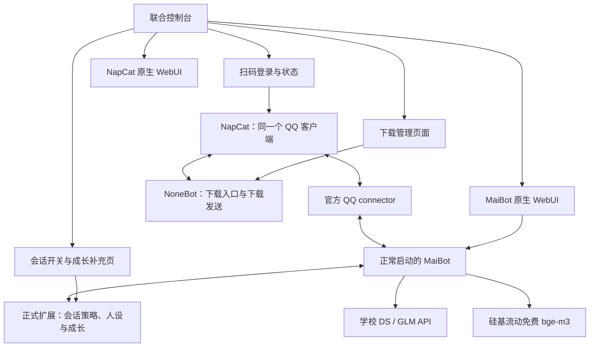

# NapCat + MaiBot 原生架构改造：执行与新聊天交接文档

日期：2026-10-25。工作区：`D:\project-of-python\JM\JMbot`。

**当前交付是实施方案；本轮已完成代码对齐但尚未把生产聊天切换为官方 connector。服务器部署前仍需按第 5 节完成 P0 证据和 NapCat 正向 WebSocket 验证。已完成一次硅基流动免费 embedding 接口实测。**

本轮代码对齐记录：联合控制台新增原生 MaiBot/NapCat 入口状态；MaiBot worker 恢复 WebUI、插件 runtime、配置 watcher，并随实例复制锁定的 SnowLuma adapter；聊天生成路由固定为服务级学校凭据；旧按会话 API Key 页面和命令退役；会话状态开始保存三字段 seed 元数据。上述内容在服务器重启和 P0 通过前不等同于迁移完成。

本文以此前本轮对服务器的只读核对为基线，区分“已核实”“实施设计”“实施前验证”。新聊天必须重新检查实时状态，不能把本文中的端口、资源和服务状态当作永久事实。

## 1. 用户已经确定的需求

1. 联合控制台继续作为入口：查看状态、扫码登录 QQ、打开各子系统。
2. QQ 的详细管理跳转 NapCat 原生 WebUI；联合控制台保留现有扫码体验。
3. 下载业务继续使用 NoneBot/JMbot 及已有自写下载管理页面。
4. 聊天迁往 MaiBot 正常启动链和官方 QQ connector，启用原生 WebUI、配置管理和原生运行能力。
5. 聊天、规划、记忆文本处理、人设提炼等生成模型只使用学校 API；DS、GLM 的任务分工由实施者决定。文本 embedding 是明确例外，使用硅基流动免费远程服务。
6. 每个群、每个私聊保留独立聊天开关。新会话默认关闭，按现有授权清单迁移后开放。
7. 每个群、每个私聊分别成长、提炼、查看和调整人设，能够冻结、保存版本和回退。不能退化为所有会话共用一份会持续覆盖的全局人设。
8. 起点人设有两种来源，针对指定群/私聊任选：A，当前自写可成长人设映射为原生字段；B，从原生 WebUI 当前保存的人设获取。初始化时保存快照，后续来源变更不静默覆盖已初始化会话。
9. 保留并收敛 MaiBot 未覆盖的补充逻辑。不是删除全部自写功能，也不是继续以完整包装器替换原生内部方法。
10. 本次统一使用服务级学校凭据，取消每群/私聊独立 Key 路由；旧 Key 命令必须退役且不能流入聊天模型。

新聊天不要重新询问以上需求。对例行、可逆的读取、实现、验证继续推进；实际停机、部署、不可逆数据处理依据届时用户授权与仓库要求执行。

## 2. 线上实际基线：不是已经完成的官方架构

| 项目 | 本轮此前只读检查结果 | 对本次实施的影响 |
| --- | --- | --- |
| 服务器 | `root@47.97.113.248` | 使用已有 SSH 密钥，不传密码 |
| JMbot | `/opt/jmbot`，部署目录不是 Git 仓库 | 不能假定服务器可以直接 git pull；需可追溯发布包 |
| MaiBot | `/opt/MaiBot`，Python 3.12.3 | 先冻结版本与依赖 |
| 上游提交 | `c602a2780f4f4dda4a6be46d67abc1cfb1ad420c` | 能力判断必须对应此版本；升级另做兼容性验证 |
| uv.lock SHA256 | `71069a89a2eb84ded3cd72814de45f70e4fd02970bb0aeb532009006c4744b9d` | 记录构建清单，不能无锁升级 |
| 服务 | `jmbot-download`、`jmbot-chat`、`jmbot-split-admin` | 需要明确替换范围与回滚入口 |
| 下载 | `main.py` / NoneBot，反向 WS 端口 8080 | 当前同时承担聊天的 QQ 传输 |
| 聊天 | `main_chat.py`，RPC `127.0.0.1:8082`，启动 `jmbot.native_worker` | 目前是自写包装运行方式 |
| 联合控制台 | `127.0.0.1:8081` | 保留入口，拆除对旧聊天协调器的强依赖 |
| NapCat WebUI | 6099，曾观测为 `*:6099` | 不能写成“当前已仅监听回环”；实施时收敛访问入口 |
| 原生管理/接入 | 没观察到 8001、3001 监听；仅 hello_world_plugin | 官方 connector 尚未安装，不能只增加一个跳转链接 |
| 原生运行 | 一个账号一个 worker，ContextVar、会话库切换、向量宿主切换和多个运行时补丁 | 隔离结果要迁移，补丁方式不照搬 |
| 禁用项 | 包装器关闭原生 WebUI、watcher、插件运行等，Focus 也被限制 | 需恢复正常启动，逐项确认配置与资源成本 |
| 资源样本 | 内存总量约 1613 MB，可用约 209 MB；swap 2047 MB，已用约 221 MB | 有过 OOM；禁止在此主机并行启动第二套完整聊天内核作迁移验证 |

当前学校模型路由记录为 DS `deepseek-flash-2` 负责多数文本任务，GLM `glm-5.3-flash` 配在 VLM；embedding 等当前停用。这是旧运行配置，不是证明模型所有能力已经验证。

现行参考：[运行说明](split-services-runbook.md)、[当前人设链路](maibot-persona.md)、[学校 API](school-api-on-server.md)、[SSH](server-ssh-access.md)、[OOM 记录](2026-10-24-server-oom-incident.md)、[源锁](../deploy/source-lock.json)。这些文档描述不同阶段，冲突时以实时进程、源码和配置脱敏核对为准。

## 3. 目标结构与职责



图中是目标职责，不是现有接线；正式 connector 的协议、端口和 NapCat 连接方向必须按锁定版本验证。

- 下载收发由 NoneBot 独立负责；聊天收发由官方 connector 独立负责。停止下载不得使聊天断线，停止聊天不得中断下载队列。
- 同一个 NapCat 可以有多个业务连接，但不能启动第二个 QQ 客户端争用登录，也不能让新旧聊天链同时回复同一消息。
- MaiBot 负责原生消息处理、规划、回复、工具、记忆和原生管理。扩展只补足会话策略、独立人设及成长版本等缺口。
- 不新建第二套 Planner，不保留“旧协调器先决定回复、再借原生生成”的双重链路。
- 联合控制台提供入口与少量聚合状态；不复制 NapCat 或 MaiBot 整个管理后台。没有验证过跨应用认证前，不承诺单点登录。

### 3.1 管理入口与端口建议

| 入口 | 建议 | 必须验证 |
| --- | --- | --- |
| 联合控制台 | 延续 8081 | 登录、session、CSRF 和扫码接口兼容 |
| 下载 OneBot | 延续 8080，最终按现有配置 | 删除转发聊天后仍能收发下载消息 |
| MaiBot WebUI | 8001 作为候选，最终以锁定配置为准 | 登录、静态资源、WebSocket、配置保存/重载 |
| NapCat WebUI | 延续 6099 | 绑定地址、认证、扫码和二次认证跳转 |
| 官方 connector | 由其文档决定 | 不能把 3001 等历史猜测写死为已配置 |

优先沿用 SSH 隧道访问管理界面。打开本机 `127.0.0.1` 链接需要对应转发已建立；页面显示实际可用地址，不把服务器回环地址直接当作任意浏览器都能访问的 URL。采用反向代理时验证子路径、WebSocket 与认证；不把 Token 放在链接查询参数中。

## 4. 原生人设、WebUI 与分会话需求的真实冲突

已核实的原生字段位于 `src/config/official_configs.py` 的 PersonalityConfig：`personality`、`behavior_style`、`reply_style`，以及备用表达风格等。`bot.nickname` 和 `alias_names` 是实例身份。原生 WebUI 编辑实例配置，并不因此自动成为每个会话的一套独立配置。

原生 WebUI 也不只管理人设：它承担原生配置和运行资源的管理；具体模型、插件、记忆等菜单以实际锁定版本为准。用户需要的“群/私聊选择起点、独立成长、提炼版本”允许放在补充页；不能伪称该版本原生已经提供这些完整功能。

### 4.1 两种起点只在初始化时取值

| 来源 | 读取对象 | 初始化动作 | 后续修改影响 |
| --- | --- | --- | --- |
| A：现有成长模板 | 当前自写可成长人设的基础模板 | 整理为 personality / behavior_style / reply_style，预览后保存来源与快照 | 只影响未来采用 A 的初始化，除非显式重置 |
| B：原生 WebUI | MaiBot 当前已保存、已生效的人设字段 | 获取一致版本的三字段快照，预览后用于选中群/私聊 | 不静默覆盖已初始化会话 |

不再叠加一份隐藏的统一固定角色。实例全局配置保留为 B 来源及原生必需的配置；所有受管理会话实际请求使用该会话的有效人设。QQ 身份昵称可保持账号一致，不要求每群更换 QQ 账号。

初始化规则：

1. 群和私聊使用同一套流程。管理员可设置新会话的默认来源 A 或 B，也可为单个会话另选。
2. 首次发现会话只建立待初始化记录；未授权会话不调用模型、不学习记忆、不触发主动聊天。
3. 选定来源后显示三字段预览、来源版本和覆盖范围，原子保存不可变 seed_snapshot 与当前 persona_version。
4. 已有会话优先导入自己的基础人设、成长摘要和增量；不能因为迁移而全部重置成当前模板。原来源无法判定时标记 imported，而不是冒充 A/B 新初始化。
5. 后续“重新应用起点”“切换来源”是显式 rebase 操作，保留原版本、成长证据和回滚路径；预览差异后执行。
6. 原生 WebUI 修改 B 后，补充页能看到新来源版本和现有会话版本不同；不能后台批量追写。

### 4.2 最小补充数据模型（设计，不是既有 schema）

优先扩展现有 ConversationStateStore 与成长版本库，避免再造一套重复状态系统。字段名称可调整，以下语义必须保留：

- `scope_key`：由账号、平台、会话类型、目标 ID 组成的稳定业务键。群与同号私聊必须不同；群中某成员的消息属于该群作用域。
- `native_session_id`：通过原生 chat_manager 解析的真实会话流 ID，建立与 scope_key 的映射。不得在业务模块自行计算 fallback hash 并写入原生库。
- `enabled`、`policy_revision`、`applied_revision`：期望状态与实际状态可核对；故障时默认拒绝。
- `seed_source`、`seed_source_revision`、`seed_snapshot`、`initialized_at`。
- `persona_version`：三字段、父版本、生成方式、证据引用、模型与提示版本、创建时间和管理员操作记录。
- `growth_cursor`、`summary_revision`、`growth_frozen`：支持增量消费、崩溃恢复和冻结。
- `migration_id`、旧新会话映射、向量模型 fingerprint 与索引 generation：支持续跑与回滚。

业务 scope_key 不能替代原生 Session ID；原生 Session ID 也不能代替业务策略里的账号边界。界面显示群名或私聊对象，ID 作为辅助信息。

### 4.3 有效人设必须只有一个权威构建位置

每次请求使用固定版本：`起点快照 + 已合并的稳定成长摘要 + 尚未合并的增量`，最终输出三字段。每条成长证据只计算一次；提炼并入摘要后推进 cursor，不再重复追加相同条目。设置长度预算，证据与原文仍可审计。

Planner、Replyer、工具相关生成和后台提炼必须获取相同 scope 的版本；同一次决策/回复周期固定版本，不能规划时是 A、回复时换成 B。禁止把群 A 的人设写进全局配置再切回群 B，异步后台任务也不能依赖这种临时全局切换。

## 5. 必须先做的原生扩展可行性验证 P0

**这是上线前的硬门槛。未通过时只能继续离线实施，不能宣称“原生聊天已支持分群人设”。**

已查到的锁定源码：

- `src/maisaka/chat_loop_service.py` 注册 `maisaka.planner.before_request`，提供 session_id、结构化 items、item_schema_version、工具定义等；允许修改请求参数，但 `allow_abort=False`，有执行时限。不能把它当作授权拒绝入口。
- 同文件注册 `maisaka.replyer.before_request`；`src/chat/replyer/maisaka_generator_base.py` 的调用路径读取 extra_prompt 等参数，但 `_build_personality_prompt()` 仍读取全局 personality，行为风格也存在全局读取。
- 所以“有 Hook”“追加 extra_prompt”不能证明三个人设字段已完整按会话替换。
- 发现原生 expression_learner、jargon_learner 和 A_Memorix；没有据此确认完整的、可独立提炼版本的分会话角色重写机制。成长补充必须保留。

### P0 验证任务及输出

1. 在本地隔离数据目录建立两个合成会话，人设设为明显矛盾的语言/风格。用模拟模型端点捕获请求正文，不使用真实聊天数据。
2. 覆盖 Planner、Replyer、工具触发生成、后台学习/提炼，并并发交错执行、重启恢复。逐项检查实际 prompt、session_id 和 persona_version。
3. 证明全局种子不会与会话 persona 同时竞争；改写 structured items 时保留 schema、工具、历史和其他字段，不能简单替换整个请求。
4. 查找消息入口、主动任务与发送出口的正式可拒绝接口；授权控制要在记忆/学习前生效，发送前再检查。非可中止请求 Hook 不足以满足此要求。
5. 对记忆、人物资料、表达、黑话、表情、Focus/主动行为逐项验证作用域。提示词中写“不要串群”不是存储隔离。
6. 输出 `docs/native-scope-spike.md`：版本、可用 API/Hook、捕获请求的脱敏证据、隔离矩阵、缺口、选型与通过/失败结论。

### 接口不足时的决策顺序

先寻找该版本正式扩展或兼容版本提供的请求级配置上下文；再评估一个边界明确的原生扩展接口，例如以 session_id 解析三字段有效人设的 provider，并由所有构建路径统一调用。升级必须连同 connector/SDK/数据库迁移一起验证，不盲目追最新。

禁止退回旧 worker 的全局 get_config、SessionLocal、MemoryHost 等大面积 monkey patch。也不要默认用“一群一个完整进程”解决问题，当前主机资源不允许。若单实例隔离没有可靠实现，应明确记录容量/接口阻塞，保持旧生产链，不以丢失用户需求换取表面上线。

上游 AGENTS 要求插件位于 plugins 下独立仓库，改主程序需许可。新聊天先判断用户届时授权是否已覆盖具体核心改动；若没有，先完成插件验证和可审阅的最小改动方案，再一次性说明文件、接口、原因并请求相应许可。不得因为此门槛停止其他已授权的独立工作。涉及 `src/A_memorix` 前必须读其 MODIFICATION_POLICY，优先在 MaiBot 接入层解决问题，避免私自演化整个向量内核。

## 6. 聊天开关、消息路由和发送权

### 6.1 双业务连接与过滤

- NapCat 向 NoneBot 和官方 connector 提供各自需要的连接，方向和协议按验证后的实际版本配置。
- NoneBot 只处理下载、下载帮助及明确归属它的管理事件，停止向旧 chat RPC 转发普通聊天。
- 官方聊天链在入库、学习和模型请求之前过滤下载命令、旧凭据命令、机器人自身消息及不适合聊天的系统事件。不要让 `/jm` 既排下载又触发一段闲聊。
- 旧“设置 Key”等精确命令保留识别与退役提示；参数不回显、不写日志、不进入历史/LLM。不能仅在后台删按钮。
- 好友/群邀请审批、自动接受请求只有一个归属者，另一路明确忽略。自发消息、重连重放按平台 message_id 去重；自写发送须有稳定 request_id，防止重试重复发送。

### 6.2 开关完整语义

关停某会话后：停止接收该作用域用于聊天处理的新消息；取消或作废在途生成；发送前再次校验最新 policy_revision；停止该会话的主动发言、学习、提炼和定时任务。保留历史数据和成长版本。管理员仍可查看、导出；显式手动提炼需单独操作，不能绕过关闭状态悄悄自动运行。

策略服务故障或找不到会话映射时默认拒绝。不能只挡 Replyer 而让 Planner/Focus/后台任务继续消耗模型和学习。开关、模型设置、persona_version、任务状态都有可观测的 desired/applied 差异。

### 6.3 锁与故障独立性

当前 `process_lease` / `qq-sender.lock` 假设唯一发送器；目标允许下载和官方聊天分别发送，但拒绝重复旧聊天实例。将锁语义拆为账号登录所有权、业务发送器身份/实例互斥，不简单删除锁。验证重启、崩溃残留与双启动。

联合控制台当前 `DomainState` 同时依赖聊天和下载 RPC，不能只改 HTML。下载页、扫码页在聊天停机时应可用；聊天状态失败只影响相应入口。

## 7. 成长、提炼和原生学习的分工

原生表达学习、黑话、记忆处理继续由原生能力承担，在证明 scope 隔离后启用。它们不等同于完整人格重写。保留 `growth_worker.py`、`persona_refinery.py`、`core/conversation_state.py` 中可复用的证据、版本、冻结、提炼流程，去掉其对旧全局补丁和旧 Key 路由的依赖。

推荐生命周期：

1. 已授权会话消息进入原生流程；补充成长只消费这个 scope 的已确认事件，记录来源 ID，重复事件不重复学习。
2. 后台按消息量/时间阈值生成候选成长条目，使用学校模型；低并发、有限输入和输出，不阻塞回复。
3. 对身份、偏好、关系、风格变化分类，区分事实记忆与人格变化，禁止把一句用户指令直接当作管理员重设。
4. 成长候选带证据；普通可逆调整可自动形成新版本，身份根本变化进入待审。管理员可以冻结或拒绝。自动规则在 UI 显示。
5. “提炼人设”把本会话稳定条目整理到三字段版本，显示 diff、模型、证据范围；确认/自动策略通过后原子切换 active version，并推进已吸收游标。
6. 回退恢复指定人设版本，记录新操作；不删除历史消息，不倒删证据，不静默清空后来产生的数据库记录。

提炼、重置种子、导出人设和清除历史是不同动作，界面不能合并成一个含糊的“重置”。群聊与私聊一致支持。

### 7.1 存储隔离验收范围

至少覆盖消息历史、事实/向量记忆、人物关系、表达、黑话、成长证据、候选/稳定人设、表情学习、主动行为和后台队列。允许实例级共享模型配置、插件程序和管理员配置；用户内容默认不跨会话共享。任何原生设计中的全局共享项必须明确禁用、改成可验证的 namespace，或列为未满足项。

## 8. 学校模型与免费 embedding

### 8.1 生成模型初始分工

| 任务 | 初始选择 | 实施验证 |
| --- | --- | --- |
| Planner、回复、文本工具、记忆文本处理 | 学校 `deepseek-flash-2` | 普通生成、结构化输出、工具协议按各任务实测 |
| 成长候选与人设提炼 | 初始同用学校 DS | 以中文提炼质量与成本决定是否切学校 GLM，记录理由 |
| 图片理解、表情图转描述 | 学校 `glm-5.3-flash` 作为候选 | 必须真实测试图片输入；不能因名称含 GLM 就假定支持 VLM |
| 文本 embedding | 硅基流动 `BAAI/bge-m3` | 本次已实测，服务器仍需复测 |
| 语音、独立图片 embedding | 暂停 | 无已验证免费/学校路由前不启用 |

模型名以学校当前可用清单与请求探针为准；不支持的任务明确停用，不自动调用外部收费 API。将提供商、模型和任务映射纳入原生配置；实际字段以锁定 MaiBot 模板为准，不把本文表格当成可直接复制的配置文件。

学校网关 `https://api.llm.ustc.edu.cn/v1`，线上依赖 iWAN HTTP 代理 `http://127.0.0.1:18080`。只对学校请求应用所需代理；不能全局代理配置导致硅基流动、本机 connector 或 RPC 走错路。检查实际客户端是否读取环境代理，显式配置必要的 NO_PROXY/按提供商客户端。

### 8.2 embedding 是什么、选哪个

embedding 把文本转成语义向量，用于相似记忆检索，不是直接把性格“训练进模型”，也不是人设成长的全部。成长由文本分析、证据和版本更新实现，embedding 帮助找回相关内容。

截图显示 `BAAI/bge-large-en-v1.5`，偏英语；官方价格页也有免费的中文 `bge-large-zh-v1.5`。本方案选择同样免费的多语言 `BAAI/bge-m3`，适合中文夹杂英文，官方文档输入上限为 8192 tokens；v1.5 系列为 512。仍需按内容切块和控制请求体。不要误选收费的 `Pro/BAAI/bge-m3`。免费政策和额度不是永久保证，上线前复核。

```text
Provider: SiliconFlow
Base URL: https://api.siliconflow.cn/v1
POST path: /embeddings
Model: BAAI/bge-m3
Encoding: float
Vector dimension: 1024
dimensions request parameter: omit
MaiBot dimension_request_mode: never（按锁定配置映射）
```

远程生成向量，本地持久化/检索向量符合需求；不是在本机运行 embedding 模型。文本 embedding 不能直接处理图片；如启用图片记忆，先用经验证的学校视觉模型生成描述，再做文本 embedding，并保留媒体关联。

### 8.3 本次真实验证及凭据交接

2026-10-25 13:42:59 UTC（北京时间 21:42:59）在本机 WSL 发送了一条合成中文输入：

- HTTP 200；响应模型 `BAAI/bge-m3`。
- 返回 1 个 1024 维向量，所有数值有限。
- usage：prompt_tokens 10、total_tokens 10。
- 没调用收费型号。此结果证明该 Key 当时可调用该接口，不代表服务器路由、长期额度或原生集成已经通过。

用户提供的真实 Key 已保存到项目之外：**Ubuntu-24.04 的 `/home/lyj/.config/jmbot/siliconflow.env`**，变量名 `SILICONFLOW_API_KEY`；父目录权限 700，文件权限 600。新聊天使用 WSL 读取，不要求用户再粘贴，不打印文件内容。不把 Key 写入 Markdown、Git、前端源码或命令行参数。该文件是本机 WSL 路径，不在服务器上。

脱敏探针回执在 `.git/online-audit-20261025/siliconflow-embedding-probe.json`，不作为版本库交付内容。部署时通过 SSH 标准输入或受限秘密文件写入服务器运行用户可读的配置，例如 `/etc/jmbot/secrets/siliconflow.env`，权限与 systemd 服务身份匹配；先检查既有文件，不能无条件覆盖。原生配置不支持环境引用时，使用受限的本地原生配置文件，不虚构环境变量插值功能。

### 8.4 向量服务故障与迁移

- 只有服务白名单中的免费模型可用；额度耗尽、模型下线、401/403/429 时明确报警，不回退收费模型、本地模型、随机/哈希伪向量。
- 429 按 Retry-After 或有限指数退避，持久化待索引状态；去重、限并发、控制重试。失败条目不标为已完成。
- 记忆索引暂时失败时可以继续基础聊天，但明确显示检索降级，不能伪称记忆检索完整；权限和人设隔离失败则该作用域停止聊天。
- 保留原文和待索引队列。模型 fingerprint 至少包含提供商、模型 ID、维度、预处理/切块版本。相同维度不代表相同向量空间。
- 新模型新建索引 generation，全量重嵌入原文、校验数量/抽样检索后切换；禁止旧新向量混放同一个索引。校验锁定原生适配器实际使用的归一化/距离方式。
- 旧实现中的哈希可能只是内容指纹或缓存键，不能仅见到 hash 就认定是本地伪 embedding。按实际调用路径判断。

官方参考：[价格](https://www.siliconflow.cn/pricing)、[Embedding API](https://docs.siliconflow.cn/docs/api/embeddings-post)。

## 9. 旧数据迁移：先证明归属，再导入

### 9.1 数据分类

| 旧内容 | 迁移方式 | 禁止操作 |
| --- | --- | --- |
| 下载队列、结果、授权和输出文件 | 保留现有下载库与业务，验证重启恢复 | 把聊天切换变成下载数据重建 |
| 会话开关/名单 | 导入 scope 策略，先拒绝后按已授权名单开放 | 默认允许所有历史群 |
| 每会话基础人设与成长 | 导入原始版本、证据、游标；映射三字段 | 用当前全局模板覆盖历史成长 |
| 模型/Key | 统一迁到学校服务商与任务配置；旧 Key 停用并按保留策略归档 | 把某群 Key 误复制为全局 Key |
| 消息与事实记忆 | 只用经核实的导入 API/显式 schema 转换 | SQLite 文件拼接、直接合并不兼容表 |
| 向量 | 按 scope 从原文新建 bge-m3 索引 | 因维度相同直接合并 |
| 表情和媒体 | 内容哈希核验文件，保留来源 scope、审核与引用 | 复制绝对路径后宣称媒体已可用 |

### 9.2 迁移工具最低要求

1. 备份真实文件、数据库一致性快照、配置、服务 unit、NapCat 连接配置和权限；给出 manifest 与校验和。SQLite 在线备份使用合适的备份机制，不能只复制主文件而漏掉 WAL。
2. dry-run 输出每作用域记录数、冲突、映射、无法导入项与空间估计，不写生产目标。
3. 真实 session_id 由原生聊天流注册/解析建立，保留旧新 ID 映射；无法解析时停在待迁移，不造 ID。
4. 分 scope、分批导入，migration_id + 来源 ID 唯一约束，支持中断续跑；再次运行不能重复增长、重复向量或重复消息。
5. 历史导入不触发 QQ 发送，也不当成新消息重新学习/自动成长；原生新学习从明确的 cutover cursor 开始。
6. 对历史证据缺失、跨 scope 原始归属不明的数据保留独立归档和报告；不猜测合并。
7. 校验数量、关联引用、媒体可读性、样本内容、每 scope 检索与提炼结果。
8. 原生没有可靠导入接口的内容先保持可读归档；用户要求保留的活跃能力需要设计明确桥接/转换并验收，不能用“归档了”代替功能实现。

### 9.3 统一配置与新会话初始化的区别

学校 API 与免费 embedding 是实例级设置；开关、人设起点/成长是会话级设置。已有会话迁移不是“新群初始化”。原生 WebUI 的全局人设作为 B 来源，不应通过热重载把全部已有会话重置。

## 10. 代码修改边界

| 现有位置 | 预期处理 |
| --- | --- |
| `src/jmbot/admin_app.py`、`templates/admin.html` | 保留登录、扫码与下载；新增原生入口及补充页，解耦 DomainState |
| `src/jmbot/napcat_admin.py` | 复用登录/二维码/状态能力；二次认证跳原生，不另造登录协议 |
| `main.py`、`core/ingress.py`、`split_adapter.py` | 收敛为下载入口，移除普通聊天转发与旧凭据配置路径 |
| `core/conversation_state.py`、`growth_worker.py`、`persona_refinery.py` | 提炼为作用域状态/成长扩展，尽量复用证据与版本逻辑 |
| `native_worker.py`、`native_sessions.py`、`native_model_work.py`、`model_request.py`、`native_emoji.py` | 逐项审计，将仍必要功能迁到正式扩展/原生配置；成功切换后退出旧运行链 |
| `chat_app.py`、`main_chat.py`、旧 RPC | 作为旧链回滚入口暂留，最终退役；不长期双写 |
| `process_lease`、发送锁 | 按登录所有权与业务实例重构，不粗暴删保护 |
| `deploy/source-lock.json` 与部署材料 | 新增官方 connector/SDK 的实际锁定信息、构建哈希与启动命令 |

所有“删除”在功能迁移、引用审计、回滚观察通过后执行。当前目录已有未提交修改，禁止 reset/clean、覆盖 README 或批量清理临时目录。用户要求以线上为准删除旧逻辑，含义是消除失效说明和退役运行路径，不是删除下载功能或未经迁移的成长数据。

## 11. 分阶段执行计划与交付门槛

### P0：重建基线、备份、验证扩展能力

- [ ] 读取本仓库/上游适用的 AGENTS 与技能；记录 git status，不覆盖既有改动。
- [ ] 只读检查线上进程、连接、源锁、配置字段、资源；保存脱敏运行清单。
- [ ] 创建并验证可恢复备份，确认空间；在本地/独立环境做恢复演练。
- [ ] 完成第 5 节请求人设/策略/存储隔离 spike；输出明确结论。
- [ ] 查证官方 QQ connector、SDK 与 MaiBot 锁定版本的兼容关系和部署方式。
- [ ] 学校模型、视觉能力、服务器免费 embedding 逐项小请求验证。

门槛：人设三字段一致、拒绝入口和学习/存储隔离均有可执行路径；若需要核心接口改动，形成最小具体方案并满足相应授权要求。

### P1：实现最小独立原生链与会话扩展

- [ ] 采用正常 MaiBot 启动入口，启用原生 WebUI、配置 watcher 与正式插件机制。
- [ ] 在 plugins 独立仓库实现 scope 策略、人设 provider、A/B 快照、版本与成长适配。
- [ ] 原生任务模型迁到学校 API，embedding 配置为免费 bge-m3。
- [ ] 接入收到消息前/后台任务前/发送前的授权与去重，覆盖主动行为。
- [ ] 通过合成请求与并发隔离测试；测试环境不连接生产 QQ 发送。

门槛：停止旧 JMbot chat wrapper 依赖后，测试环境仍能完成原生处理与独立成长；所有未覆盖的原生共享资源有明确处理。

### P2：控制台和下载解耦

- [ ] 联合控制台保留扫码，添加 NapCat/MaiBot 原生入口和补充页。
- [ ] 下载页独立，聊天服务不可用时可查询和操作下载队列。
- [ ] 下载入口不转发聊天；聊天过滤下载/旧 Key 命令，自发消息和审批有唯一归属。
- [ ] 分业务调整 sender/process lease，验证重复实例被拒绝。

门槛：管理入口、扫码、下载原有操作无回归；独立停机测试通过。

### P3：迁移演练与资源验收

- [ ] 在生产副本上 dry-run/迁移/续跑/回滚演练，不连接 QQ。
- [ ] 实现会话映射、增长游标、bge-m3 新索引、媒体映射和数量报告。
- [ ] 从一个群、一个私聊的复制数据开始，验证既有成长版本和两种新初始化方式。
- [ ] 构建与部署包包含源锁、插件独立提交、依赖锁、配置模板和迁移工具。
- [ ] 本机/隔离环境测资源，服务器切换时只运行一套完整内核。后台初始并发 1，限制索引批量，避免上传/提炼/下载同时达到峰值。

资源门槛：观察峰值 RSS、可用内存、swap 活动、OOM 计数、回复和下载延迟。不要只凭“启动成功”验收。按实测制定服务资源限额与余量；若不足，减并发或扩容，不能静默牺牲隔离。

### P4：受控生产切换

切换前准备完成具体配置 diff、备份位置、发布清单、回滚命令和预计中断范围，再根据届时授权执行维护动作。

1. 记录 T0 与策略/消息游标，暂停旧聊天接收、后台成长和发送，排空或作废在途工作。
2. 做最终一致性备份与增量迁移，旧数据目录保持只读可回滚。
3. 调整 NapCat 业务连接，先确保 NoneBot 下载链独立可用，再启用官方 connector 和唯一新聊天内核。不要同时运行新旧聊天。
4. 新聊天策略先全关，只开放管理员指定的一个群、一个私聊；验证种子、人设、记忆、图片、开关和下载命令过滤。
5. 检查原生 WebUI 配置保存/重载、两种起点预览与快照、分会话成长提炼。
6. 按清单逐个放行原授权会话；查看错误、限流、队列、资源与重复回复。

### P5：观察、回滚准备与清理

- [ ] 建议至少覆盖一次高峰及后台成长/索引周期，默认观察 24–48 小时，异常则延长。
- [ ] 对照第 12 节验收矩阵留证，不以服务 active 代替业务验证。
- [ ] 回滚演练能保全 T0 之后消息、成长与操作，不只恢复旧目录。
- [ ] 通过后删除旧聊天启动依赖、废弃菜单/配置与无引用补丁；保留有保留期限的备份、迁移报告和历史事故文档。
- [ ] 更新 README、运行说明、架构状态和 source-lock，使文档与真正上线的结构一致。

## 12. 验收矩阵

| 场景 | 通过标准 |
| --- | --- |
| 联合控制台登录与扫码 | 状态、二维码刷新、登录完成与异常跳转正常 |
| 原生管理入口 | NapCat 和 MaiBot 可登录；原生配置保存重载可见 |
| 单个群开/关 | 关闭后不入聊天模型/学习、不发主动或在途回复；其他群正常 |
| 单个私聊开/关 | 与群同样完整，群与同号用户不串策略 |
| A/B 起点 | 两来源可预览并应用指定会话，快照/版本完整 |
| 修改原生全局人设 | B 来源更新，已初始化会话不被静默覆盖 |
| 并发矛盾人设 | Planner、Replyer、工具、后台都使用正确 scope 和固定版本 |
| 成长与提炼 | 群 A 证据不影响群 B/私聊；提炼不重复叠加，冻结和回退可恢复 |
| 原生记忆/表达/表情 | 各作用域内容、人物关系、黑话与检索不串用 |
| 免费 embedding | 实际请求仅 bge-m3；1024 维有限值；无 dimensions 参数冲突 |
| embedding 故障 | 有限退避、待索引持久化、可恢复，无收费或伪向量回退 |
| 学校模型 | 所有生成任务走学校；代理失效明确报错，不挪用其他 Key |
| 下载与旧 Key 命令 | 下载只入队一次，聊天不响应；凭据不进日志/LLM |
| 重连与重启 | 不重发、不重复学习，策略和 persona_version 可恢复 |
| 独立停机 | 停下载不影响聊天收发；停聊天不影响下载与扫码管理 |
| 审批和发送锁 | 请求唯一处理，无重复自动审批，重复业务实例被拒绝 |
| 历史迁移 | 计数/媒体/版本/ID 映射可核验，重跑幂等 |
| 回滚 | 保留 T0 后数据并能重新实施，无旧新索引混用 |
| 主机容量 | 无 OOM；高峰与后台周期可用，积压有界 |

应写有意义的作用域隔离、权限竞态、迁移幂等与数据保全测试。小的链接/文字修改无需编写镜像实现的测试；较大 WebUI 功能按项目约定验证构建。真实 QQ 验收使用明确测试会话，不对全部生产群试发。

## 13. 回滚步骤与触发条件

触发：跨 scope 人设/记忆、权限关闭仍发送、下载中断、重复回复、持续 OOM/服务重启、迁移校验不一致，或无法恢复的模型路由错误。

1. 先关新聊天入口与发送、暂停成长/索引写入，再停止新内核和 connector；下载若正常则继续。
2. 对新系统做 T1 快照及 T0–T1 增量导出，保留消息、成长版本、策略操作和索引状态；不是直接删除新目录。
3. 恢复旧配置、NapCat 连接与旧服务启动定义，确认仅旧链拥有聊天发送权。
4. 旧数据目录若原封保留，可恢复其运行；T0 后新数据留在增量归档，经过验证的兼容转换才回灌，不直接把新 schema 库覆盖旧库。
5. 复测下载、一个群和一个私聊；记录未回灌数据及后续续迁移游标。
6. 修复后从 migration checkpoint 重试，不能重新全量导入造成重复。

回滚是恢复可用性并保全数据，不代表承诺能无损即时把任意新功能数据写回旧 schema。上线前必须用演练报告讲清可恢复范围与步骤。

## 14. 新聊天工作环境与现有工作成果

### 14.1 本机执行方式

- Windows shell 工具必须显式设置 `shell: C:\Windows\System32\bash.exe`、`login: false`，使用 WSL Ubuntu-24.04。
- 工作区的 WSL 路径 `/mnt/d/project-of-python/JM/JMbot`；技能目录 `/mnt/c/Users/LJY/.codex/skills`。
- 复杂 Bash/文档通过 UTF-8 Base64 传递或 apply_patch 编辑，避免 Windows Bash 入口提前解释反引号等字符。
- 当前 WSL 未安装 rg，可用 git grep/find/grep；不要因为这个改用 PowerShell。
- 网络操作遵循 web-access 技能；浏览器用专用 Chrome，CDP 9222、代理 13457，不能连接日常配置。SSH 等沿用相应本机工作方式。

### 14.2 只读 SSH 基础命令

```bash
ssh -i ~/.ssh/aliyun-codex \
  -o BatchMode=yes -o IdentitiesOnly=yes \
  -o StrictHostKeyChecking=yes -o ConnectTimeout=10 \
  root@47.97.113.248 'systemctl is-active jmbot-download jmbot-chat jmbot-split-admin'
```

不要打印服务器 env、学校 Key、NapCat Token 或 SSH 私钥。脱敏读取启动项时注意 ExecStart 与环境文件也可能含秘密。

### 14.3 不要覆盖的本地工作

此前本轮已按线上源码同步部分运行文件，未提交；还存在用户已有 README 改动及其他未跟踪文档/临时产物。备份位置：`.git/online-audit-20261025/`、`.git/before-online-sync-20261025/`。

本地上游源码快照 `.git/upstream/maibot/` 没有自己的 .git；在其中执行 git rev-parse 可能得到父仓库 JMbot 的提交，不能据此认定 MaiBot 版本。以服务器 `/opt/MaiBot` 的真实 Git 及源锁核对。

历史记录：同步后曾进行 60 个 Python 源文件与线上快照归一化比对、语法检查及定向测试（50 passed、1 skipped）。这些是旧链验证，不是本方案完成证明。本文编写仅做文档验证和免费 API 探针，不能把之前测试结果当成未来迁移已经通过。

### 14.4 方案复核（karpathy-check）

| 复核项 | 结论 | 执行约束 |
| --- | --- | --- |
| 假设与理解 | Flag | 原生三字段替换及资源隔离有待 P0，不假定原生已覆盖 |
| 方案与取舍 | Pass | 原生主链 + 最小会话补充，保留下载与统一入口 |
| 复杂度 | Pass | 复用现有成长状态，不造第二 Planner、不一群一进程 |
| 正确性 | Flag | 权限竞态、并发 scope、向量 namespace 必须有证据 |
| 范围 | Pass | 分阶段迁移与退役，不混入下载业务重写 |
| 表述与证据 | Pass | 明确事实、设计、未知项及探针边界 |
| 迭代验收 | Pass | 硬门槛、矩阵、观察及保全回滚均已定义 |

建议：Proceed 到 P0 调研与离线实施；P0 通过前不进行生产切换。

## 15. 可直接发给新聊天的启动指令

> 请阅读 `D:\project-of-python\JM\JMbot\docs\2026-10-25-native-chat-migration-plan.md`，按其中用户已确定的需求实施。以实时线上部署为准，先只读复核、备份并完成 P0 原生分会话人设/权限/存储隔离验证，再逐阶段实现。保留联合控制台扫码、NapCat 原生管理、NoneBot 下载管理；聊天使用正常启动的 MaiBot、官方 QQ connector 和原生 WebUI。每群与每私聊有独立开关、A/B 起点快照、成长和提炼版本。生成模型只用学校 API；embedding 用硅基流动免费 BAAI/bge-m3，Key 在 WSL `/home/lyj/.config/jmbot/siliconflow.env`，不要再次索要或打印。复用有价值的自写成长逻辑，避免全局 monkey patch，不覆盖工作区已有修改。使用 WSL Bash。持续更新文档中的进度与验收证据，完成具体可审阅方案后再处理需要授权的生产动作；不得将未通过的原生能力写成已经完成。
